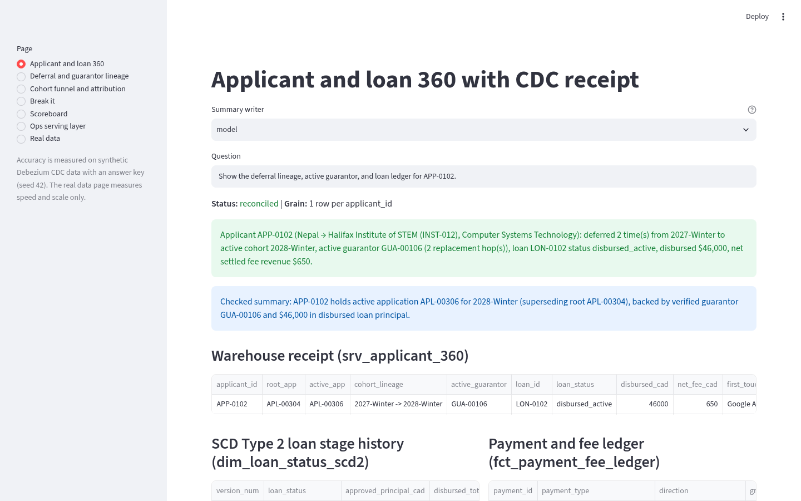
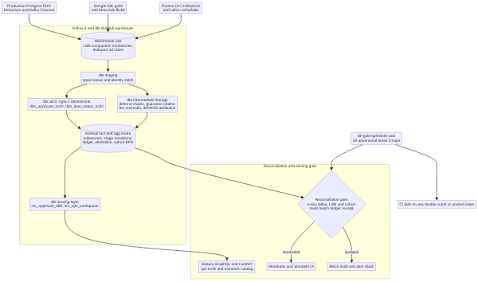
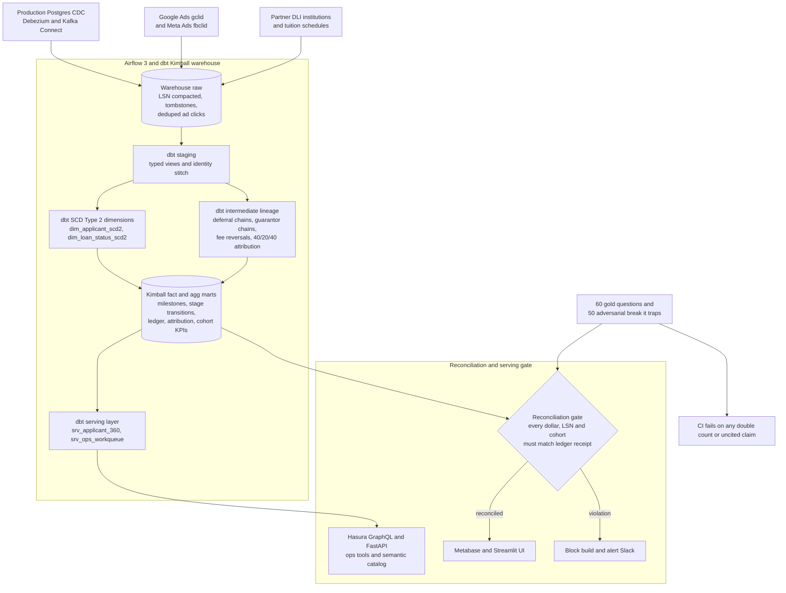
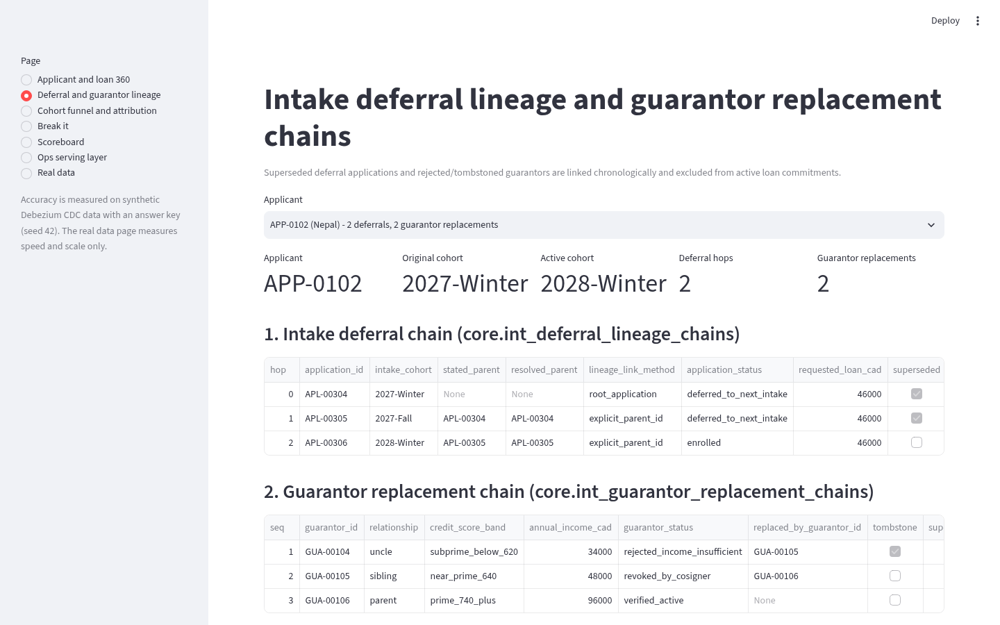
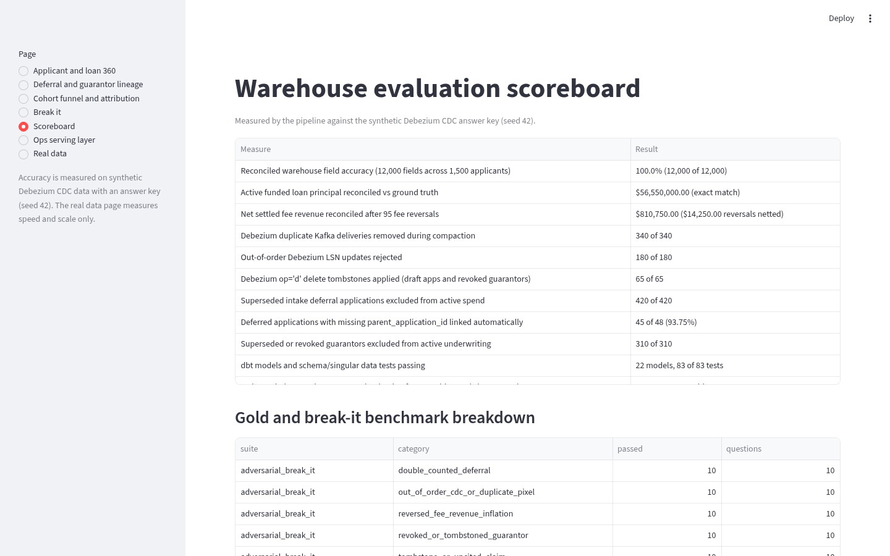

# Student loan journey warehouse

[](https://github.com/manishreddy998/student-loan-journey-warehouse/actions/workflows/ci.yml)

Kimball dimensional warehouse on dbt, BigQuery, and DuckDB for international student admissions, education loan underwriting, intake deferral lineage, guarantor replacement chains, payment and fee reconciliation, and multi-touch ad-click attribution over Debezium Postgres CDC.

Every metric reconciles to its source Postgres LSN and ledger receipt: deferred intakes (`2026-Winter -> 2026-Fall -> 2027-Winter`) are chained to the root application so loan commitments are never double-counted, replaced or tombstoned co-signers are excluded from active underwriting, reversed processing fees are netted out of fee revenue, and every model syncs its grain and metric definitions to [`catalog/MODELS.md`](catalog/MODELS.md) and [`hasura/`](hasura/).

Accuracy is measured on synthetic Debezium CDC data with an answer key (`seed=42`). Real public data (federal IRCC, ESDC, and post-secondary education service contract disclosures) is used for columnar scan speed and scale only.



## Run it

```bash
docker compose up --build
```

One command generates the 25,760-event synthetic Debezium CDC stream and ad-click log, runs LSN log compaction, builds all 22 dbt models and 83 data tests across `staging -> dimensions -> intermediate -> marts -> serving`, syncs the semantic catalog and Hasura GraphQL metadata, runs the 60 gold and 50 break-it checks, and serves:

| Service | URL |
|---|---|
| Dashboard (`streamlit run src/dashboard.py`) | http://localhost:8501 |
| Serving API (`/applicant/{id}`, `/cohorts`, `/attribution`, `/workqueue`, `/scoreboard`) | http://localhost:8130 |

Or run locally without Docker:

```bash
pip install -r requirements.txt
make all
streamlit run src/dashboard.py
```

Set `GCP_PROJECT_ID` and `WAREHOUSE_TARGET=bigquery` in `.env` to load tables into Google BigQuery with date partitioning and clustering and run the pipeline via the Airflow 3 DAG (`dags/student_journey_dag.py`). By default, everything runs out of the box on local DuckDB and dbt.

## Architecture



Source: [docs/architecture.mmd](docs/architecture.mmd)



1. **Debezium Postgres CDC corpus (`seed=42`).** 25,760 CDC envelope events (`op` in `c`, `u`, `d` with Postgres `lsn` and `before`/`after` payloads) across 6 operational tables (`applicants`, `applications`, `screening_checks`, `loan_contracts`, `guarantors`, `payments_and_fees`), 30 partner Designated Learning Institutions (DLIs), 1,500 international student applicants, 1,920 academic applications, and 3,640 Google Ads (`gclid`), Meta Ads (`fbclid`), and UTM click events.
2. **CDC compaction and LSN ordering (`src/cdc_loader.py`).** Removes 340 duplicate Kafka deliveries on `(source_table, pk_value, lsn)`, rejects 180 out-of-order stale `lsn` arrivals, applies 65 `op='d'` delete tombstones (40 abandoned draft applications and 25 revoked guarantors), and materializes ordered state history for SCD Type 2 dimensions.
3. **Kimball SCD Type 2 dimensions (`dbt/models/dimensions/`).** `dim_applicant_scd2` (4,500 versions across 1,500 applicants) tracks point-in-time KYC verification, risk tier, and study permit changes with `valid_from`, `valid_to`, and `is_current`. `dim_loan_status_scd2` (5,400 versions across 1,500 loans) tracks underwriting and disbursement stage durations (`hours_in_stage`).
4. **Deferral lineage, guarantor chains, fee reversals, and attribution (`dbt/models/intermediate/`).**
   - `int_deferral_lineage_chains`: Chains 300 applicants who defer across 1 or 2 subsequent intakes (`420` child deferral rows) back to `root_application_id` and marks earlier rows `is_superseded_by_deferral = true` so cohort funnels and loan commitments are never double-counted.
   - `int_guarantor_replacement_chains`: Resolves 260 co-signer replacement chains (`310` rejected or revoked guarantor rows) so only the verified terminal guarantor is active on underwriting.
   - `int_payment_fee_reconciliation`: Pairs 95 fee refund/reversal entries (`reverses_payment_id`) against original processing fees and reconciles tuition and living-stipend disbursements.
   - `int_ad_click_attribution`: Deduplicates 140 duplicate pixel fires, stitches 55 multi-device anonymous sessions via verification token, and computes First-Touch, Last-Touch, and Position-Based (`40% / 20% / 40%`) attribution weights.
5. **Kimball marts, Hasura serving layer, and auto-synced catalog (`dbt/models/marts/`, `dbt/models/serving/`, `src/catalog_sync.py`).** Exposes `fct_applicant_milestones`, `fct_loan_stage_transitions`, `fct_payment_fee_ledger`, `fct_marketing_attribution`, `agg_cohort_funnel_kpis`, and dedicated Hasura GraphQL serving tables (`srv_applicant_360`, `srv_ops_workqueue`), while auto-generating [`catalog/MODELS.md`](catalog/MODELS.md) and [`catalog/warehouse_context.json`](catalog/warehouse_context.json).

## Results

Measured by the pipeline on the synthetic Debezium CDC answer key (`seed=42`), from [`results/scoreboard.json`](results/scoreboard.json).

| Measure | Result |
|---|---|
| Reconciled warehouse field accuracy (12,000 fields across 1,500 applicants) | 100.0% (12,000 of 12,000) |
| Active funded loan principal reconciled vs ground truth | $56,550,000.00 (exact match) |
| Disbursed tuition and living stipend total reconciled | $56,550,000.00 (exact match) |
| Net settled fee revenue reconciled after 95 fee reversals ($14,250.00 netted) | $810,750.00 (exact match) |
| Duplicate Kafka CDC deliveries removed during compaction | 340 of 340 |
| Out-of-order Debezium LSN updates rejected | 180 of 180 |
| Debezium `op='d'` delete tombstones applied (draft apps and revoked guarantors) | 65 of 65 |
| Superseded intake deferral applications excluded from active spend | 420 of 420 |
| Deferred applications with missing `parent_application_id` linked automatically | 45 of 48 (93.75%) |
| Ambiguous long-gap program switches routed to `core.lineage_review_queue` | 3 of 48 |
| Superseded or revoked guarantors excluded from active underwriting | 310 of 310 |
| Duplicate ad-click pixels deduplicated and anonymous sessions stitched | 140 of 140 deduped, 55 of 55 stitched |
| dbt models and schema/singular data tests passing | 22 models, 83 of 83 tests |
| Estimated BigQuery bytes-scanned reduction from partition and cluster pruning | 86.0% across 7 tables |
| Gold warehouse questions answered with verified LSN receipt | 60 of 60 |
| Adversarial break-it checks passed (0 uncited claims) | 50 of 50 |

### Real public data (speed and scale only)

Measured on public federal IRCC, ESDC, and education service contract disclosures, from [`results/real_benchmark.json`](results/real_benchmark.json).

| Measure | Result |
|---|---|
| Federal contract rows scanned | 1,313,327 rows in 5.57 s (235,739 rows/s) |
| IRCC and ESDC department contracts matched | 62,407 |
| Education, tuition, study permit, and language testing service contracts matched | 45,753 |
| Public tender notices scanned | 7,199 rows in 0.49 s (14,731 rows/s) |

Contact names, emails, and phone numbers in the public tender file are never loaded.

## Screenshots

| | |
|---|---|
| Applicant and loan 360  | Intake deferral and guarantor replacement chains  |
| Scoreboard  | Architecture  |

## How to verify

1. Run `make all && streamlit run src/dashboard.py` (or `docker compose up --build`) and open http://localhost:8501/?page=Applicant+and+loan+360.
2. Select `Deferral and guarantor lineage` in the left sidebar (`http://localhost:8501/?page=Deferral+and+guarantor+lineage`) to inspect multi-term intake deferrals (`is_superseded_by_deferral`) and co-signer replacement chains (`is_superseded_guarantor`).
3. Run `make test` to execute the 83 dbt data tests, 60 gold questions, 50 adversarial break-it traps, and pytest suite.
4. Inspect [`catalog/MODELS.md`](catalog/MODELS.md) and [`hasura/schema.graphql`](hasura/schema.graphql) for the auto-synced model grains, metric formulas, and GraphQL serving schema.

## Limits

- Three of the 48 deferred applications where `parent_application_id` was omitted in Postgres also involved a 68-day submission gap and a program change at the same institution (`93.75%` auto-linked within the 45-day same-program rule). Those 3 records are flagged in `core.lineage_review_queue` and surfaced in `serving.srv_ops_workqueue` for ops confirmation rather than relaxing the window and merging distinct program applications automatically.
- Local runs execute against DuckDB (`dbt-duckdb`); BigQuery `PARTITION BY` and `CLUSTER BY` pruning savings (`86.0%`) are calculated from table row sizes and partition selectivity in `src/warehouse.py`.

## Layout

```text
src/                synth_cdc_corpus, cdc_loader, warehouse, catalog_sync, reconcile_gate, evaluate, real_data, api, dashboard
dags/               Airflow 3 DAG with Debezium freshness sensor, dbt build tasks, and Slack failure alert callback
dbt/                22 models (staging, dimensions, intermediate, marts, serving) and 83 schema and singular data tests
hasura/             Hasura GraphQL table metadata and GraphQL schema over serving.srv_applicant_360 and srv_ops_workqueue
catalog/            Auto-synced warehouse_context.json and MODELS.md with explicit grain and metric SQL definitions
scripts/            render_assets.py (renders Mermaid diagram and captures live light-mode Streamlit screenshots)
tests/              pytest unit and integration suite
results/            measured numbers from the last run
```

## Author

**Manish Reddy**, Data/AI Engineer (2x Google Cloud Certified: Professional Data Engineer & Associate Cloud Engineer), Toronto

- Email: manishreddyr998@gmail.com
- GitHub: [manishreddy998](https://github.com/manishreddy998)
- LinkedIn: [manish-re-50c02a719k](https://www.linkedin.com/in/manish-re-50c02a719k/)

## License

MIT, see [LICENSE](LICENSE).
